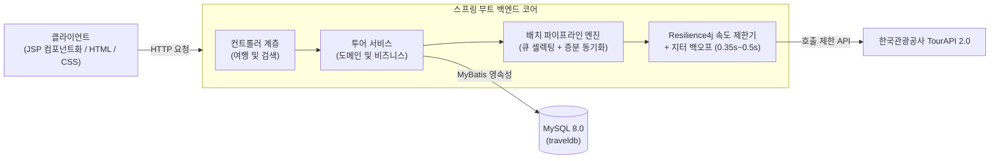

<div align="center">

### 여행부터 관광지, 맛집까지 올인원 예약 플랫폼 찾아?

## 공공데이터 기반 통합 여행 정보 & 스마트 동기화 파이프라인 플랫폼 <갈래말래>

한국관광공사 TourAPI 연동부터 대용량 데이터 지능형 수집, 트래픽 제어 파이프라인까지
안정적인 백엔드 인프라와 데이터 파이프라인 구축에 집중한 프로젝트입니다.

`Spring Boot` · `Java 17` · `MyBatis` · `MySQL` · `Resilience4j` · `Jitter` · `WebClient` · `한국관광공사 공공데이터 API`

</div>
[**GitHub Repository →**](https://github.com/beautiyj/travel-community)

</div>

<br>

> **[이미지 : 서비스 대표 썸네일 / 메인 화면 캡처]**
> (이미지넣는용도 폭이 너무 크지 않게 `width="700"` 정도로 조절 필)

<br>

---

## Github 팀장 김윤정 역할 소개

- **프로젝트 명** : 갈래말래 (통합 여행 정보 및 예약·커뮤니티 플랫폼)
- **개발 기간** : 2026.06 ~ 2026.08 (팀 프로젝트 · 6인)
- **담당 역할** : **백엔드 리드 및 배치 파이프라인 설계 (여행 콘텐츠, 공공데이터 연동, Resilience4j 트래픽 제어, 고품질 데이터 동기화 담당)**
- **핵심 목표** : 공공데이터 API의 호출 한도 병목을 극복하고, 고품질 데이터만 선별·적재하는 지능형 배치 파이프라인 및 백엔드 아키텍처 구축

<br>

---

## 📌 Overview

여행지 탐색, 숙박·맛집 예약, 여행 후기 공유가 각각 다른 서비스에 흩어져 있어 정보가 분산되고 예약 과정이 번거로운 문제에서 출발했습니다.

**갈래말래**는 정보 탐색부터 결제, 커뮤니티 소통, 사업자 관리까지 하나의 플랫폼에서 연결하여 예약 중개 수수료와 지역 업체 제휴를 통한 비즈니스 모델을 확보하고, 소규모 지역 업소의 온라인 노출 기회를 넓히는 통합 여행 솔루션을 목표로 개발했습니다.

기존의 플랫폼의 한계와 문제점 3가지, 먼저 **정보의 파편화**로 숙소, 맛집, 관광지 정보가 제각각 흩어져 있어 일일이 비교하고 수집하기 번거로운 문제,
**예약 프로세스의 번거로움**으로 인해 탐색 이후의 결제 및 예약 내역을 통합적으로 관리할 수 있는 신뢰성 있는 채널이 부재한 점,
마지막으로 **신뢰도 낮은 후기**로 단순 광고성 후기가 많아 실제 방문자 중심의 검증된 정보를 얻기가 어려운 점에서부터 시작하여 사용자의 편의를 고려했습니다.

1. **공공데이터 표준화 & 탐색 고도화** : 전국 관광지·숙박·맛집 데이터를 수집·정제하여 직관적인 UX를 제공했습니다.
2. **신뢰 기반 예약·결제 라이프사이클** : 만료 스케줄링, 결제 위변조 방지, 차등 환불 정책을 포함한 안전한 거래 환경을 구축했습니다.
3. **방문자 인증 커뮤니티 & 사업자 분석** : 결제 검증 후기, 에디터 모듈, 사업자 대시보드 및 NLP 후기 감성분석 기능을 제공했습니다.

<br>

---

## 🏗 시스템 아키텍처 (공공데이터 연동 및 동기화를 포함한 데이터 파이프라인 전체 담당)



<br>

---

## ✨ Core Features

### 1) 지능형 큐 셀렉팅(Queue Selecting) 엔진 & 배치 파이프라인

* **고품질 데이터 선별** : 단순 필드 체크를 넘어 대표 이미지 4장 이상, 상세 소개, 이용요금을 연쇄 호출(Chain Call)로 검증하여 고품질 데이터만 선별해 적재했습니다.
* **스마트 증분 동기화(Incremental Sync)** : `modifiedtime` 기반 변동 데이터 및 폐업(`showflag=0`) 데이터를 감지하여 해당 지역만 핀포인트로 수량을 보충하도록 구현했습니다.

**[이미지 : 여행 콘텐츠 목록/필터링 화면]**

### 2) Resilience4j 기반 외부 API 트래픽 제어 파이프라인

* **429 예외 선제 방어** : 공공데이터 API 연쇄 호출 시 초당 호출 한도 초과로 발생하는 병목(Thundering Herd Problem)을 막기 위해 Resilience4j RateLimiter를 도입했습니다.
* **동적 백오프 적용** : 무작위 오차 변수(Jitter)를 결합하여 0.35초~0.5초 사이의 동적 지연을 적용함으로써 트래픽 스파이크를 분산시키고 안정적인 대용량 데이터 수집 파이프라인을 완성했습니다.

**[이미지 : 화면]**

### 3) 여행 콘텐츠 도메인 및 검색·필터링 API 총괄

* **팀 내 데이터 편의성** : 시/도 및 시/군/구 단위 법정동 지역 필터와 테마별(관광, 숙박, 맛집) 다차원 필터링 로직을 구현했습니다.
* **사용자 편의** : 최신순, 금액순, 제목순 정렬 및 자동 해시태그 생성 로직을 백엔드 단에서 처리하여 응답 속도를 최적화했습니다.

**[이미지 : 화면]**

### 4) 클린아키텍처 기반 JSP 컴포넌트화·팀원 가이드 배포

* **클린아키텍처 컴포넌트화** : 재사용 및 수정 용이성을 위한 JSP 컴포넌트화를 담당하였으며 팀원들에게 컴포넌트화 사용 가이드를 배포했습니다.

**[이미지 : 화면]**

### 5) 토스, 카카오, 구글 API 및 Keras연동 가이드라인 제공

* 이전의 프로젝트 경험을 통해 배운 지식과 API 연동 개념, 공식 가이드라인을 포함한 코드를 팀원들에게 배포했습니다.

**[이미지 : 화면]**

<br>

---

## 🛠️ 기술 스택

### Backend & Batch

| 기술 | 버전 / 용도 | 상세 설명 |
|:---|:---|:---|
| **Java** | 17 (OpenJDK) | 모던 자바 문법 및 Record, Stream API 활용 |
| **Spring Boot** | 3.5.16 | 핵심 웹 애플리케이션 프레임워크 및 의존성 주입 |
| **MyBatis** | 3.0.5 | SQL 매핑 기반 RDBMS 데이터베이스 영속성 제어 |
| **Resilience4j** | RateLimiter, Retry, Jitter 백오프 처리 | 외부 API 초당 호출 제어 및 선제적 429 방어 |
| **Spring WebClient** | Reactive WebClient | 대용량 외부 공공 API 비동기/논블로킹 호출 |

### Frontend & Media

| 기술 | 버전 / 용도 | 상세 설명 |
|:---|:---|:---|
| **JSP / JSTL** | Jakarta 3.0.0 | 서버 사이드 템플릿 렌더링 및 공통 컴포넌트화 |
| **JavaScript** | ES6+ Modular | 에디터, 캘린더, 슬라이더 모듈 분리 설계 |
| **HTML5 / CSS3** | Standard | 반응형 카드 뷰 및 사이드바 레이아웃 구성 |

### Database & Infra

| 기술 | 버전 / 용도 | 상세 설명 |
|:---|:---|:---|
| **MySQL** | 8.0.46 | RDBMS 메인 스토리지 (외래키 CASCADE/무결성 보장) |
| **Git / GitHub** | 형상 관리(VCS) | 기능별 브랜치 전략 및 Pull Request 코드 리뷰, 전체 팀 코드 병합(Merge) 총괄 팀장 |

<br>

---

## 담당 디렉토리 구조 (Batch & Tour)

```
com.gnagnoohc.travel
├── batch/                # 공공데이터 수집 및 동기화 배치 파이프라인
│   ├── client/           # TourApiClient (WebClient 비동기 통신)
│   ├── converter/        # TourDataConverter, HashtagGenerator
│   ├── dto/              # 공공데이터 응답 DTO 및 법정동 DTO
│   ├── helper/           # TourApiHelper (연쇄 수집, 요금/좌표 파싱)
│   ├── scheduler/        # TourBatchScheduler (새벽 3시 자동 실행)
│   ├── service/          # TourApiService (증분 동기화, 큐 셀렉팅 엔진 구현)
│   └── validator/        # TourValidator (블랙리스트, 부실데이터 검증)
├── config/               # WebClientConfig, MyBatisConfig
├── tour/                 # 여행/숙박/맛집 도메인, 검색, 필터링
│   ├── model/            # DTO, Entity 분리 형태
│   ├── mapper/
│   ├── service/
│   └── controller/
└── FE/                   # 프론트엔드 공통 모듈 및 컴포넌트 구조화
    └── common/           # 슬라이더, 콜라주, 캘린더 등 공통 UI 컴포넌트화
```

<br>

---

## ⚙️ 트러블슈팅 하이라이트

### 1. 외부 API 429(Rate Limit) 예외 대응 및 트래픽 분산

* **문제** : 고품질 데이터 선별을 위해 상세 이미지, 소개정보, 객실/가격정보를 포함한 데이터 조건 연쇄 호출(Chain Call)하는 과정에서 공공데이터 API의 초당 호출 한도를 초과해 배치가 중단되는 429 에러가 발생했습니다.
* **원인** : 고품질 데이터 선별을 위한 조건으로 인해, 단건의 데이터를 처리할 때마다 유효성 검증을 위한 세부 정보 조회가 연쇄 반복(Chain Call)되는 구조로 1초 미만의 짧은 윈도우 타임 내에 수십~수백 건의 폭발적인 버스트 트래픽(Burst Traffic)이 동시다발적으로 유발되었습니다.
* **해결** : Resilience4j RateLimiter를 시스템 전역에 적용해 초당 허용 요청 건수를 엄격히 제한하고, 무작위 오차 변수인 Jitter를 가미한 백오프(0.35s~0.5s)를 동적으로 부여하여 요청 타이밍을 철저히 분산시킴으로써 429 예외 발생률을 0%로 수렴시키고 파이프라인의 안정성을 확보하였습니다.

**[이미지 : 화면]**

### 2. Git 로컬-전역 병합 정책 불일치로 인한 브랜치 추적 이탈 해결 및 형상 관리 리드

* **문제** : GitHub PR 처리 후 로컬에서 `git pull`을 실행하면 리모트 트래킹 브랜치 추적 연동이 이탈하는 현상이 발생했습니다.
* **원인** : 로컬 `.gitconfig`의 전역 병합 설정과 GitHub PR Merge 전략 사이에 차이가 있어 로컬 커밋 트리와 원격 커밋 트리가 서로 어긋났습니다.
* **해결** : 팀 내 Local/Global Git Config의 병합 정책을 정리하고, GitHub Repository의 PR Merge Strategy를 명확히 규격화하여 문제를 해결했습니다.
* **성과** : 전체 Git 브랜치 전략 수립 및 PR 리뷰, 최종 통합(Merge) 총괄 담당하며 안정적인 데모 빌드 환경 유지하였습니다.

<br>

---

## 📆 개발 일정

* **1주차 (기획·분석)** : 주제 선정, 요구사항 분석, DB 설계(ERD), 역할 분담을 진행했습니다.
* **2주차 (설계)** : 개발 환경을 세팅하고 DB 설계와 UI/UX 설계를 진행했습니다.
* **3주차 (핵심 개발)** : 회원/인증, 커뮤니티, 여행지·숙박·맛집, 예약·결제, 사업자 기능을 구현하고 Git으로 기능을 병합했습니다.
* **4주차 (마무리)** : 통합 테스트와 QA를 진행하고 최종 발표를 준비했습니다.

<br>

---

## 👥 팀 구성 및 역할

| 이름 | 담당 파트 | 주요 담당 업무 |
|:---:|:---:|:---|
| **김동주** | 회원 / 인증 / 관리자 | Auth 패키지(로컬·소셜 로그인, 회원가입, 이메일 인증)와 Admin 패키지(사업자 인증 신청 조회, 승인·반려 트랜잭션)를 개발했습니다. |
| **김윤정** (Github Leader) | 여행 콘텐츠 / 배치 | 한국관광공사 TourAPI 연동과 여행 콘텐츠 페이지를 총괄했으며, 3단계 큐 셀렉팅 엔진과 Resilience4j 트래픽 제어 파이프라인, 증분 동기화 스케줄러를 구축하고 브랜치 관리·병합을 총괄했습니다. |
| **김태희** | 사업자 / 감성분석 | 사업자 전용 관리자 대시보드(KPI 통계, 매출 콤보 차트)와 Komoran & KNU 감성사전 기반 후기 긍/부정 분석 및 워드클라우드를 개발했습니다. |
| **송우진** | 예약 / 결제 | 숙박/맛집/관광지 맞춤형 예약 폼과 예약 기능을 개발했으며, 카카오페이 연동 및 결제 만료 스케줄러, 멱등성 환불 로직을 구현했습니다. |
| **이다희** | 커뮤니티 / 토스결제 | 커뮤니티 게시판과 콜라주/슬라이더 자동 생성 에디터를 구현했으며, 토스페이먼츠 연동 기능을 개발했습니다. |
| **장철순** | 마이페이지 | 마이페이지 UI와 회원정보 관리, 찜/예약 목록 관리 기능을 구현했으며, 회원 탈퇴 및 로그아웃 예외 처리 프로세스를 설계했습니다. |
